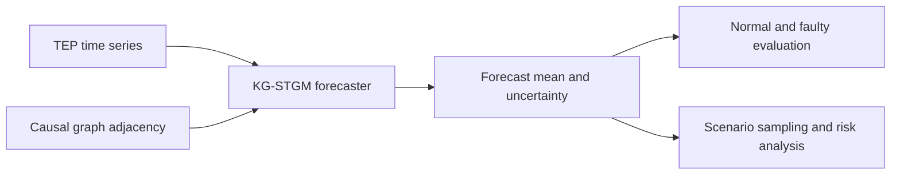

# KG-STGM Framework

**Knowledge-Guided Spatiotemporal Graph Mamba for the Tennessee Eastman Process (TEP).**

The implementation models a 33-node causal knowledge graph (22 measured process variables and 11 manipulated variables) to generate multistep probabilistic forecasts. Evaluation scripts examine fault-free and faulty trajectories; risk analysis samples forecast scenarios.

## Architecture



## Repository structure

| Module | Purpose |
| --- | --- |
| [train.py](src/train.py) | Data loading, model training and checkpoints |
| [testing_normal.py](src/testing_normal.py) | Fault-free evaluation and metrics |
| [testing_faulty.py](src/testing_faulty.py) | Faulty-run forecasts and residual statistics |
| [process_risk.py](src/process_risk.py) | Distribution calibration, scenario sampling and risk scoring |

## Installation

```bash
git clone https://github.com/rohanst14/KG-STGM-Framework.git
cd KG-STGM-Framework
python -m venv .venv
# Activate the environment for your OS.
python -m pip install -r requirements.txt
python src/train.py --help
```

## Training and evaluation

Supply the required TEP datasets and graph adjacency before running:

```bash
python src/train.py --data-npz path/to/training.npz --adjacency-npy path/to/graph.npy --out-dir kg_stgm_outputs
python src/testing_normal.py --help
python src/process_risk.py --help
```

The faulty evaluation imports an unpublished local module. See [reproducibility notes](docs/reproducibility.md) for required inputs and known limitations.

## Acknowledgment and citation

The training source identifies [MGCN for Traffic Prediction](https://github.com/Vincent665/MGCN-for-Traffic-Prediction) as the reference implementation. Cite the repository URL and exact commit; see [CITATION.cff](CITATION.cff). No license or publication DOI is asserted. Dependencies are source-derived and not version-locked. Research code is not a validated operational safety system.
