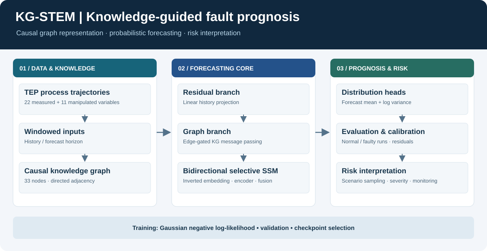

# KG-STEM Framework

**Knowledge-Guided Spatio-Temporal Graph Mamba (KG-STEM) for interpretable fault prognosis in process systems.**

The repository name and internal source identifiers retain the earlier KG-STGM naming.

The implementation models a 33-node causal knowledge graph (22 measured process variables and 11 manipulated variables) to generate multistep probabilistic forecasts. Evaluation scripts examine fault-free and faulty trajectories; risk analysis samples forecast scenarios.

[](https://doi.org/10.1016/j.compchemeng.2026.109967)

## Publication

Rohan Thakur, Zaman Sajid, Faisal Khan. (2027). KG-STEM: A knowledge-guided framework for interpretable fault prognosis in process systems. *Computers & Chemical Engineering*, 217, 109967. [10.1016/j.compchemeng.2026.109967](https://doi.org/10.1016/j.compchemeng.2026.109967).

[Publisher article](https://www.sciencedirect.com/science/article/pii/S0098135426004199) | [DOI](https://doi.org/10.1016/j.compchemeng.2026.109967)

## Architecture



The KGSTGMBlock combines a residual projection and a graph-message-passing branch with inverted embedding and bidirectional selective state-space encoding. Forecast heads predict mean and log variance for measured variables; downstream scripts evaluate normal and faulty runs and estimate risk.

## Repository structure

| Module | Purpose |
| --- | --- |
| [train.py](src/train.py) | Data loading, model training and checkpoints |
| [testing_normal.py](src/testing_normal.py) | Fault-free evaluation and metrics |
| [testing_faulty.py](src/testing_faulty.py) | Faulty-run forecasts and residual statistics |
| [process_risk.py](src/process_risk.py) | Distribution calibration, scenario sampling and risk scoring |

## Installation

```bash
git clone https://github.com/rohanst14/KG-STGM-Framework.git
cd KG-STGM-Framework
python -m venv .venv
# Activate the environment for your OS.
python -m pip install -r requirements.txt
python src/train.py --help
```

## Training and evaluation

Supply the required TEP datasets and graph adjacency before running:

```bash
python src/train.py --data-npz path/to/training.npz --adjacency-npy path/to/graph.npy --out-dir kg_stgm_outputs
python src/testing_normal.py --help
python src/process_risk.py --help
```

The faulty evaluation imports an unpublished local module. See [reproducibility notes](docs/reproducibility.md) for required inputs and known limitations.

## Acknowledgment and citation

The training source identifies [MGCN for Traffic Prediction](https://github.com/Vincent665/MGCN-for-Traffic-Prediction) as the reference implementation. Please cite the associated paper and record the repository commit used. No software license is asserted. Dependencies are source-derived and not version-locked. Research code is not a validated operational safety system.

## BibTeX

```bibtex
@article{Thakur2027KGSTEM,
  author = {Thakur, Rohan and Sajid, Zaman and Khan, Faisal},
  title = {{KG-STEM: A knowledge-guided framework for interpretable fault prognosis in process systems}},
  journal = {Computers & Chemical Engineering},
  year = {2027},
  volume = {217},
  pages = {109967},
  doi = {10.1016/j.compchemeng.2026.109967},
  url = {https://doi.org/10.1016/j.compchemeng.2026.109967}
}
```

Machine-readable citation: [CITATION.cff](CITATION.cff).
